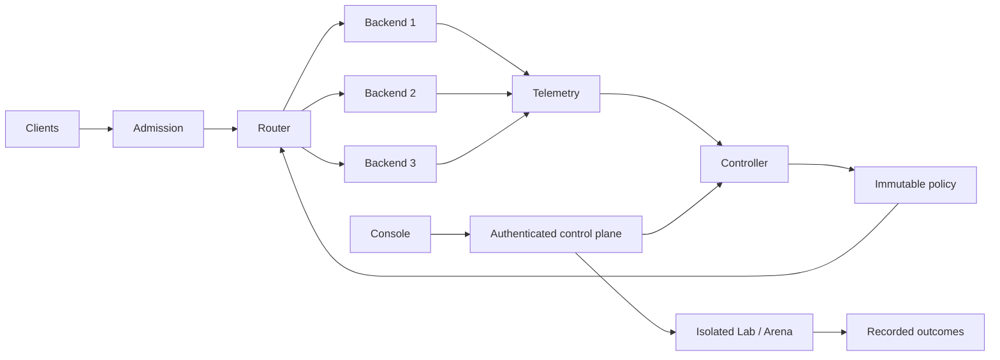

<div align="center">

# PULSE
### Adaptive Traffic Intelligence Engine

**Traffic is a signal. Read it.**

Don't just distribute traffic. Understand it.

[](https://github.com/ashoka0402/Adaptive-L7-Load-Balancer/actions/workflows/verify.yml)

[Quick start](#quick-start) · [Console](docs/console.md) · [Benchmarks](docs/benchmarks/README.md) · [Demo](docs/demo.md) · [Architecture](ARCHITECTURE.md)

</div>

Pulse is a production-inspired asynchronous Layer 7 HTTP reverse proxy and traffic experimentation engine. Rather than always selecting the lowest-latency server, it uses multidimensional feedback and immutable policy snapshots to distribute requests among eligible backends. Prediction, SLO-aware weight blending and optional bounded learning build on that controller.

## The system



| Capability | Behavior |
| --- | --- |
| Pulse Core | Baseline algorithms and multidimensional probabilistic routing |
| Pulse Predict | Bounded regression forecasts and class-aware fingerprints |
| Autopilot | SLO feedback, bounded objective blending, cooldown and rollback |
| Resilience | Health checks, circuit breakers, cancellation-safe backpressure and retries |
| Lab / Chaos | Seeded queues and isolated local HTTP workloads with scheduled faults |
| Arena / Replay | Eight experiment strategies, identical seeded traces, raw results and synchronized playback |
| Shadow | Sampled decision estimates without duplicate upstream traffic |
| Console | Live sampled topology, charts, experiment controls, SLO settings and backend inspector |

## Quick start

Python 3.12+ or Docker. Set unique local secrets; never use production credentials for a demo.

```powershell
$env:PULSE_ADMIN_TOKEN = "replace-with-a-long-random-secret"
$env:GRAFANA_ADMIN_PASSWORD = "replace-with-a-different-random-secret"
docker compose up --build
```

Open **http://localhost:8080/pulse/** and enter the configured admin token. Prometheus is at port 9090 and Grafana at 3000. Services bind to loopback by default.

For development without Docker use `python -m pip install -e '.[dev]'`, start local demo backends, configure their loopback addresses and run `python -m app.main -c config/config.yaml`. See the [guided demo](docs/demo.md).

## Screenshots and verification

Actual landing, overview, Arena and mobile screenshots are generated by the Chromium test and uploaded in the `pulse-console-browser-evidence` artifact. [Open Actions and choose a successful run](https://github.com/ashoka0402/Adaptive-L7-Load-Balancer/actions). These are real application screenshots, not mockups. No UI metric is hardcoded as measured data.

```bash
python -m pytest -ra
ruff check .
mypy app
node --test frontend_tests/model.test.mjs
```

## Routing and performance

The adaptive score combines weighted normalized latency, concurrency, queue pressure, error rate and resource signals. The controller adds a bounded prediction penalty and maps scores to probabilities, accounting for weight, slow start, exploration and movement limits. Eligibility and circuit checks remain mandatory.

One previously recorded deterministic simulation reported 66 errors for Pulse adaptive versus 118 for EWMA, with higher p95 latency (19.38 ms versus 15.22 ms). That is a scenario-specific trade-off, **not an HTTP throughput improvement**. See the committed [raw benchmark evidence](docs/benchmarks/README.md).

The release workflow generates a same-runner historical/current HTTP comparison and Docker Arena reports. Download raw JSON from CI, including any unfavorable outcomes.

## API and deployment

All `/admin/*` endpoints require bearer authentication. The API covers backends, external telemetry, routing policy and weights, intelligence, Autopilot and runtime SLOs, experiments, SSE progress, replay/export, and shadow results. [Console](docs/console.md) and [experiment API](docs/experiments.md) document the operations. New backend destinations must be explicitly configured in the startup allowlist.

## Engineering notes

[Architecture](ARCHITECTURE.md) · [Implementation status](IMPLEMENTATION_STATUS.md) · [Release boundaries](docs/release.md) · [Interview guide](docs/interview.md) · [Contributing](CONTRIBUTING.md) · [Security](SECURITY.md)

Pulse is single-process and intended for trusted local experimentation. It is not a production-readiness certification. See the release notes for known limits before deployment.
