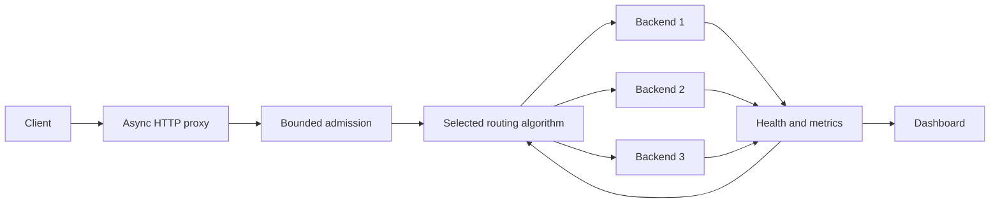

# Pulse — Layer 7 Load Balancer

A focused Python asyncio project that demonstrates HTTP reverse proxying, routing algorithms, backend health, fault tolerance and real performance measurement. Built for learning and technical interviews, not marketed as a production replacement for NGINX or AWS.

## Run locally

Start Docker Desktop and run from the repository in PowerShell:

```powershell
docker compose up --build -d load-balancer
```

Open **http://localhost:8080/pulse/**; the dashboard connects automatically. If port 8080 is occupied, set `$env:PULSE_PORT = "8081"` before starting Compose and open port 8081 instead. The internal container port stays 8080.

To start optional Prometheus and Grafana, set a unique `GRAFANA_ADMIN_PASSWORD` (Grafana has its own login), then run `docker compose up -d prometheus grafana`. Stop the demo with `docker compose down`.

## Two screens

- **Dashboard:** switch the real routing algorithm, see request counts, throughput, latency percentiles, errors, backend health, active connections, queue pressure and distribution; generate bounded paced or unpaced HTTP traffic and disable/re-enable backends.
- **Battle Arena:** compare all four algorithms using the same seeded workload. Choose real local HTTP or labeled queue simulation. View throughput, latency, errors and backend distribution. Choose normal, slow backend, outage/recovery or limited capacity scenarios. Dark and light themes are available.

## Four routing algorithms

| Algorithm | How it works |
| --- | --- |
| Round Robin | Rotate across available backends |
| Weighted Round Robin | Smooth distribution in configured weight proportions |
| Least Connections | Select the fewest active upstream requests |
| EWMA | Prefer lower measured latency with a simple load penalty |

Core reliability includes active/passive health checks, circuit breakers, safe bounded retries before response streaming, connection pooling, timeouts, bounded concurrency and backpressure. Management is a token-free local demo, protected from cross-origin browser requests; do not expose it to other hosts. The console uses actual instance telemetry and experiment results.



## Verification

```bash
python -m pip install -e '.[dev]'
python -m pytest -ra
ruff check .
mypy app
node --test frontend_tests/model.test.mjs
python -m benchmarks.run_arena --output reports/arena.json
```

[GitHub Actions](https://github.com/ashoka0402/Adaptive-L7-Load-Balancer/actions) runs Python tests, type checking, Chromium browser tests, a real HTTP benchmark and Docker smoke checks. The browser artifact contains actual screenshots. No performance result is assumed.

[Architecture](ARCHITECTURE.md) · [Demo guide](docs/demo.md) · [Benchmark methodology](docs/benchmarks/README.md) · [Interview guide](docs/interview.md) · [Security and limits](docs/release.md)

The earlier experimental adaptive intelligence engine was intentionally removed. Its source and historical measurements remain available in Git history. EWMA remains a conventional feedback-based routing algorithm, not an AI or predictive controller.
