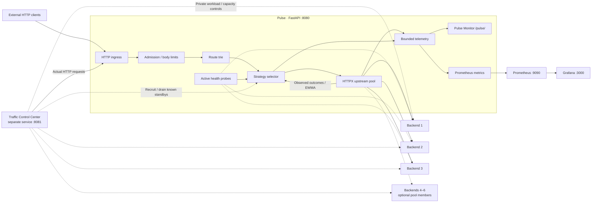
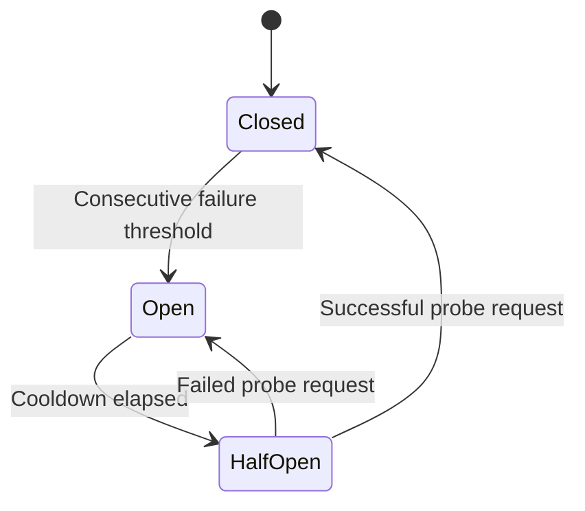
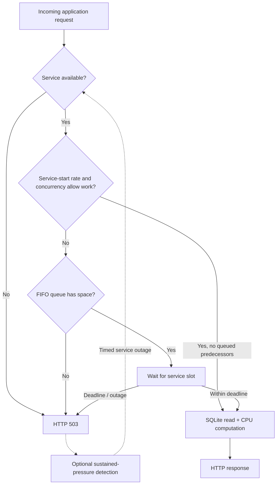
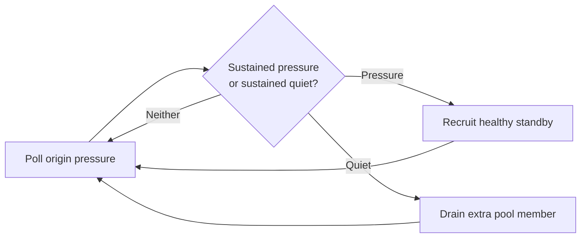

# Pulse — Adaptive Layer 7 Load Balancer

**Route real traffic. Observe failures. Measure recovery.**

Pulse is an asynchronous, application-layer HTTP reverse proxy and interactive systems-engineering laboratory built in Python. It distributes real HTTP requests across independent application servers, adapts routing decisions using observed latency and outstanding work, and exposes the behavior of the system through live dashboards and reproducible experiments.

The project demonstrates the engineering behind load balancing, backpressure, circuit breakers, connection pooling, failure isolation, capacity management and observability — without relying on a third-party load balancer to perform the core routing logic.


[Quick start](#quick-start) · [Architecture](#system-architecture) · [Routing algorithms](#routing-algorithms) · [Interactive demos](#interactive-demonstrations) · [Benchmarks](#benchmarking-and-evidence)

> **Scope:** Pulse is a working local HTTP proxy and experimental infrastructure project, not a production-ready cloud load balancer. Live Mode forwards actual client traffic; its optional sample workloads and fault experiments are controlled synthetic tests. Management interfaces must remain local.

## Table of contents

- [Why Pulse?](#why-pulse)
- [Key capabilities](#key-capabilities)
- [System architecture](#system-architecture)
- [Routing algorithms](#routing-algorithms)
- [Resilience and request handling](#resilience-and-request-handling)
- [Quick start](#quick-start)
- [Interactive demonstrations](#interactive-demonstrations)
- [Capacity-based overload and autoscaling](#capacity-based-overload-and-autoscaling)
- [Operating modes](#operating-modes)
- [Configuration](#configuration)
- [Observability](#observability)
- [HTTP interfaces](#http-interfaces)
- [Benchmarking and evidence](#benchmarking-and-evidence)
- [Technology stack](#technology-stack)
- [Repository structure](#repository-structure)
- [Testing and CI](#testing-and-ci)
- [Security and limitations](#security-and-limitations)
- [Troubleshooting](#troubleshooting)
- [Engineering takeaways](#engineering-takeaways)
- [Attribution and contributing](#attribution-and-contributing)

## Why Pulse?

A load balancer should do more than distribute requests equally. Backend servers can differ in processing time, available capacity and failure behavior. Under heterogeneous or changing workloads, a fixed routing policy may send requests to a server that is already struggling.

Pulse makes these trade-offs observable:

- What happens when one healthy server becomes slower than its peers?
- How do active health checks differ from passive failure detection?
- When should requests be rejected rather than queued indefinitely?
- How does a circuit breaker prevent repeated calls to an unhealthy origin?
- Can a recovered backend gradually participate in routing again?
- What changes when spare capacity is added to the routing pool?

The goal is to demonstrate these concepts through actual HTTP traffic and measurable outcomes, not to assume that adaptive routing always wins.

## Key capabilities

| Capability | Implementation |
| --- | --- |
| Layer 7 reverse proxy | FastAPI/ASGI, asynchronous HTTPX upstream requests and streamed responses. |
| Content-based routing | Longest matching URL path-segment prefix using a route trie. |
| Routing strategies | Eight selectable policies, including latency-aware EWMA with exploration. |
| Health monitoring | Active HTTP probes and passive request outcomes; separate probe connection pool. |
| Circuit breaking | Closed, open and half-open states with controlled recovery probes. |
| Safe retries | Bounded GET/HEAD retries, alternate-origin selection and retry budget. |
| Backpressure | Bounded active requests and explicit overload rejection. |
| Connection pooling | Shared asynchronous upstream client and persistent connections. |
| Live observability | Request rates, latency percentiles, backend state, timing breakdowns and sampled routing traces. |
| Traffic Control Center | Independent service generating paced, real HTTP requests with configurable arrivals. |
| Chaos engineering | Timed service outages, application errors, timeouts and transport disconnects on bundled test origins. |
| Capacity experiments | Per-origin service-start rate, concurrency, FIFO queue, deadline and timed overload failure. |
| Local autoscaling | Recruit and drain up to three prestarted standby services. |
| Strategy comparisons | Measured Round Robin vs. EWMA under matched capacity and workload conditions. |
| Optional isolated lab | Breaking Point, Arena, canary rollout/rollback, incident replay and resilience controls. |
| Monitoring integration | Prometheus metrics and provisioned Grafana dashboard. |

## System architecture

Pulse separates the **data plane** (request routing and forwarding) from the local experiment and management controls.



The default Compose environment starts six independent sample application containers. Three are initially registered with the proxy; the remaining three are available as standby capacity. The Traffic Control Center is not embedded in the proxy. Requests it sends travel through the real HTTP data plane.

The sample applications use **SQLite reads and PBKDF2 CPU computation**. Normal workloads do not simulate application latency with sleeps. Explicit timeout/fault experiments deliberately alter behavior at the origin.

### Request lifecycle

1. Accept an HTTP request and enforce proxy admission and request body limits.
2. Match the longest configured path-segment prefix to an upstream pool.
3. Exclude unavailable, disabled, draining, open-circuit or currently probing origins.
4. Select an eligible backend using the configured strategy.
5. Forward the original path and query through HTTPX, removing unsafe or hop-by-hop headers.
6. On eligible GET/HEAD failures, optionally retry another origin within the retry budget.
7. Stream the upstream response back to the client and release resources even on disconnect.
8. Record completion latency, selected backend, outcomes and observed upstream timing.

The original aiohttp engine is retained for historical comparison, but the **default runtime is FastAPI**, launched through `app.main`.

## Routing algorithms

Pulse implements eight strategies in [app/fastapi_lb/routing.py](app/fastapi_lb/routing.py).

| Strategy | Configuration value | Decision |
| --- | --- | --- |
| Round Robin | `round_robin` | Cycle through eligible backends. |
| Weighted Round Robin | `weighted_round_robin` | Smooth weighted selection according to configured backend weights. |
| Least Connections | `least_connections` | Select the backend with the fewest outstanding requests; use backend ID to break ties. |
| Least Latency | `least_latency` | Select the lowest observed EWMA latency. |
| Least Loaded | `least_loaded` | Minimize outstanding requests plus EWMA latency divided by 100. |
| Power of Two Choices | `p2c` | Sample up to two eligible backends and choose the lower load score. |
| IP Hash | `ip_hash` | Hash the client IP to select an eligible backend. Membership changes may change the mapping. |
| Latency Aware | `latency_aware` | Minimize EWMA latency multiplied by an outstanding-request penalty, with exploration. |

All policies operate on eligible backends rather than blindly routing to every configured origin. The first route in the bundled configuration uses Latency Aware by default.

### How adaptive routing works

An exponentially weighted moving average (EWMA) smooths observed response timing while retaining sensitivity to changes.

For a successful observation, after initialization:

```text
EWMA_new = 0.2 × observed_latency_ms + 0.8 × EWMA_previous
```

The first successful observation initializes the EWMA. Ordinary completed responses below HTTP 500 update the backend using upstream header-arrival timing; proxy completion latency is a separate measurement.

The latency-aware policy scores eligible origins:

```text
score = (EWMA_ms or 50) × (1 + outstanding_requests)

Choose the eligible backend with the lowest score.
```

The outstanding-request penalty helps avoid concentrating work on an origin whose latency estimate is favorable but whose current load is increasing.

For example, these are illustrative scores, not benchmark results:

| Backend | EWMA | Outstanding requests | Score |
| --- | ---: | ---: | ---: |
| A | 12 ms | 3 | 48 |
| B | 30 ms | 0 | 30 |
| C | 16 ms | 1 | 32 |

In this example B has the lowest score, despite having the highest measured latency, because it currently has no outstanding work.

### Exploration and recovery

Always choosing the lowest score could starve a previously slow backend of new observations. Pulse addresses this with:

- Cold-start exploration of idle backends without a latency sample.
- Stale-observation exploration for eligible idle origins not selected for at least two seconds.
- Periodic exploration every twentieth selection when the earlier exploration rules do not apply.

Consequently, a slow but healthy origin can still receive occasional requests and demonstrate recovery. The algorithm uses measured upstream feedback and outstanding work, **not the configured capacity limits** of the overload laboratory. It is a feedback-based heuristic, not machine learning or a guaranteed optimal scheduler.

## Resilience and request handling

| Mechanism | Current default-runtime behavior |
| --- | --- |
| Active health checks | Probe configured health endpoints approximately every second using a separate HTTPX client; a null health path disables active probing for that origin. |
| Passive outcomes | Track upstream failure/success observations and circuit-breaker state. |
| Circuit breaker | Opens after three consecutive failed outcomes; a three-second open interval precedes half-open probing. |
| Retry safety | At most two attempts for GET/HEAD, subject to budget and alternative availability. Transport failures and HTTP 502/503/504 can trigger eligible retries. |
| Retry budget | Shared token budget, replenished by incoming requests, limits amplification. |
| Admission | Default maximum of 100 active proxy requests; excessive requests receive 503 and Retry-After. |
| Request body | Buffered up to 10 MiB with a ten-second body-read deadline. |
| Connection pool | HTTPX defaults in the application: up to 120 connections and 60 keep-alive connections. |
| Upstream timeout | HTTPX timeout configuration of five seconds, with a two-second connect timeout. |
| Response streaming | Stream upstream response bytes and shield resource cleanup on disconnect. |
| Optional rate limiter | Token-bucket policy available through the isolated experimental controls. |

The five-second HTTPX timeout is an operation timeout configuration, not a guarantee of a five-second total request deadline. Retries are deliberately restricted to GET/HEAD and cannot guarantee that an incorrectly designed GET endpoint has no side effects.

### Circuit-breaker lifecycle



Active health status and circuit-breaker eligibility are separate signals: a backend can pass its health endpoint but still fail application requests.

## Quick start

### Option A — Docker Compose (recommended)

**Requirements:** Git, Docker Engine/Desktop with Compose v2, and free local ports 8080 and 8081. No host Python installation is required.

```bash
git clone https://github.com/ashoka0402/Adaptive-L7-Load-Balancer.git
cd Adaptive-L7-Load-Balancer
docker compose up --build -d traffic-center
docker compose ps
```

This starts Pulse, the Traffic Control Center and all six independent sample backends through Compose dependencies.

Open these two dashboards side by side:

| Interface | Address | Purpose |
| --- | --- | --- |
| **Pulse Monitor** | [http://localhost:8080/pulse/](http://localhost:8080/pulse/) | Proxy-side throughput, latency, routing and health |
| **Traffic Control Center** | [http://localhost:8081/](http://localhost:8081/) | Client traffic, workload changes, faults and capacity experiments |

Send a real application request:

```bash
curl -i http://localhost:8080/api/items/7
curl -i http://localhost:8080/api/items/18
```

On Windows PowerShell, use `curl.exe` instead of `curl` if the latter resolves to a PowerShell alias.

Inspect `X-Backend`, `X-Pulse-Routing-Us` and `X-Pulse-Upstream-Headers-Ms` in the response headers. The root URL is an application route, not the management dashboard.

### Optional Prometheus and Grafana

```bash
docker compose up -d prometheus grafana
```

| Service | URL |
| --- | --- |
| Metrics exposition | [http://localhost:8080/pulse/metrics](http://localhost:8080/pulse/metrics) |
| Prometheus | [http://localhost:9090/](http://localhost:9090/) |
| Grafana | [http://localhost:3000/](http://localhost:3000/) |

Grafana uses the `admin` account and the configured `GRAFANA_ADMIN_PASSWORD` (the Compose development fallback is `local-grafana-change-me`). Set your own password before starting Grafana. The provisioned dashboard and Prometheus datasource are in [monitoring/](monitoring/).

The monitoring services are optional; starting only `traffic-center` does not automatically start Prometheus and Grafana.

### Option B — Native Python

Requires Python 3.12 or newer. From the repository root:

```bash
python -m venv .venv
```

Activate the virtual environment:

```powershell
# Windows PowerShell
.\.venv\Scripts\Activate.ps1
```

```bash
# Linux / macOS
source .venv/bin/activate
```

Install dependencies:

```bash
python -m pip install -r requirements.txt
```

Launch each sample origin in a separate terminal (using the same environment):

```bash
python -m backends.workload --id backend-1 --port 8001
python -m backends.workload --id backend-2 --port 8002
python -m backends.workload --id backend-3 --port 8003
```

Start the default proxy in another terminal:

```bash
python -m app.main
```

The proxy uses [config/live.local.json](config/live.local.json) and listens on loopback port 8080. The basic monitoring dashboard and external HTTP forwarding work with these three origins. Use Docker Compose for the complete six-origin capacity, chaos and standby-recruitment experience.

### Stop or update

```bash
docker compose down

# On a later session, update and rebuild:
git pull origin main
docker compose up --build -d traffic-center
```

See [START_HERE.txt](START_HERE.txt) for a step-by-step startup and demonstration guide.

## Interactive demonstrations

All demonstrations below target the bundled local sample services. Do not direct the traffic generator or fault controls at third-party systems.

### Demo 1 — Observe real load balancing

In the Traffic Control Center, configure:

| Setting | Suggested value |
| --- | --- |
| Offered request rate | 40 requests/sec |
| Duration | 120 seconds |
| Maximum in-flight requests | 32 |
| Arrival pattern | Constant |

Click **Start real traffic**. Observe client response counts and latency in the Traffic Control Center, alongside proxy throughput, backend assignments, latency percentiles and successful-response distribution in Pulse.

The generator supports 1–300 offered requests/sec, 5–120 seconds, and up to 64 in-flight requests. Its offered rate is not guaranteed achieved throughput.

### Demo 2 — Adaptive routing under degradation

1. Select **Latency Aware (EWMA + Load)** in Pulse.
2. Start constant traffic for 120 seconds and observe the initial distribution.
3. In the Traffic Control Center, select backend-2 and increase CPU work to 200,000 iterations.
4. Observe upstream latency and how the strategy redistributes requests.
5. Restore normal work and observe whether the backend regains traffic.
6. Stop traffic, reset workload and fault state, and repeat with Round Robin using identical settings.

This changes actual CPU computation, without injecting a sleep. Relative shares, adaptation time and performance depend on measurements; no improvement is guaranteed. Use the independent benchmark runner for repeatable results.

### Demo 3 — Chaos Mode

With traffic running, select a bundled backend, choose a bounded recovery duration and inject one fault at a time.

| Fault | Origin behavior |
| --- | --- |
| Take offline | Application and health endpoint return HTTP 503. |
| Return 503 | Application returns 503 while the health endpoint remains healthy. |
| Return HTTP 500 | Affected application requests return 500. |
| Intermittent 500s | Every third affected request returns 500. |
| Request timeout | Delay application response beyond expected timeout settings. |
| Drop connection | Abort the actual TCP transport. |

Observe the distinction between active health status, circuit-breaker state, client errors and retries.

Faults expire automatically at the origin, even if the Traffic Control Center stops. **Recover selected** and **Recover all** clear injected faults; CPU workload changes are reset separately.

The service-offline button is a controlled HTTP outage, not a literal container crash. To demonstrate a real process outage in the local Compose cluster:

```bash
docker compose stop backend-2
docker compose start backend-2
```

## Capacity-based overload and autoscaling

The capacity laboratory applies limits inside the independent sample applications rather than feeding fictitious capacity values into the routing algorithm.

### Origin-side admission model



The gate supports paced service starts, maximum concurrent work, a bounded FIFO queue and a two-second queue deadline. Limits are initially disabled to preserve the normal live workload.

Apply the heterogeneous preset in **Capacity & Overload Lab**:

| Origin | Service-start limit | Concurrency | Queue slots |
| --- | ---: | ---: | ---: |
| backend-1 | 25 req/s | 8 | 12 |
| backend-2 | 50 req/s | 8 | 12 |
| backend-3 | 80 req/s | 8 | 12 |
| backend-4–6 (each) | 80 req/s | 8 | 12 |

The initial nominal aggregate service-start limit is 155 req/s with that preset. It is **not** a measured sustainable throughput figure; computation, concurrency, retries and queueing can reduce actual goodput.

With overload failure enabled, sustained queue pressure or repeated rejection can trigger a timed service-level outage and failed health probes. The default preset cooldown is ten seconds. No operating-system crash or uncontrolled resource exhaustion is needed.

### Traffic scenarios

The center includes **Traffic Spike, Ramp to Failure, Traffic Tsunami, Bursty Traffic, Cascading Overload and Recovery Test**. The scenario presets are bounded at 280 offered requests/sec for 45 seconds. Whether cascading failures actually occur is an experimental outcome.

### Standby recruitment and scale-in



Enable autoscaling in the capacity lab. The controller polls origin state and routing membership, observes sustained pressure or quiet periods, and uses a cooldown between scaling actions.

- Scale-out adds a known prestarted standby (backend-4, backend-5 or backend-6).
- Scale-in drains an extra backend before removing it from the routing pool.
- The initial three members remain the base pool.
- The scaling policy reads origin capacity state, but the EWMA selector does not.

This is **local routing-pool autoscaling**, not infrastructure provisioning: no Docker socket, cloud API, Kubernetes controller or new container creation is involved. Standby containers remain running after scale-in.

### Measured comparison

Apply capacity limits to all active backends and select **Run measured comparison**. The controller compares Round Robin and Latency Aware using the same fixed membership, traffic settings and capacity configuration, resets fault/CPU state, and disables autoscaling during the comparison.

Export the resulting JSON to examine client latency, goodput, losses, origin rejections and failure counts. Avoid unrelated requests and configuration changes during the test. Repeat runs before drawing conclusions from an exploratory comparison.

## Operating modes

| Mode | How to start | Purpose |
| --- | --- | --- |
| Live Mode (default) | `python -m app.main` | Forward externally generated HTTP traffic to trusted independent applications. |
| Compose sample cluster | `docker compose up --build -d traffic-center` | Live Mode plus separate real workload generator, six test origins and controlled experiments. |
| Laboratory Mode | `python -m app.main --lab` | Isolated child-process origins and a separate generator for additional experiments. |
| Legacy Mode | `python -m app.main --legacy` | Preserved original aiohttp runtime for comparison and historical experiments. |

Live Mode does not generate its own traffic. Dashboard requests and health probes are not counted as proxied application traffic.

The explicit isolated Laboratory Mode retains eight features: Breaking Point, Chaos Lab, Request X-Ray, scenario Arena, local autoscaling, bounded incident replay, canary rollout/rollback and resilience-policy controls. Destructive lab controls are disabled in Live Mode. The separate Compose Traffic Control Center exposes only its bounded sample-origin experiments.

To start the isolated lab in Docker, first stop the live services to avoid port conflicts:

```bash
docker compose down
docker compose run --rm --service-ports --no-deps load-balancer python -m app.main --lab --host 0.0.0.0
```

Open the Pulse dashboard on port 8080. For additional experimental documentation, see [docs/experiments.md](docs/experiments.md) and [docs/demo.md](docs/demo.md); some older examples concern the preserved runtime.

## Configuration

Pulse accepts a trusted JSON or YAML route registry at startup.

```bash
python -m app.main --config config/live.local.json
```

Example registry for your own authorized applications:

```json
{
  "server": {
    "host": "127.0.0.1",
    "port": 8080
  },
  "routes": [
    {
      "prefix": "/users",
      "strategy": "weighted_round_robin",
      "backends": [
        {
          "id": "users-a",
          "url": "http://127.0.0.1:8001",
          "weight": 1,
          "health_path": "/health"
        },
        {
          "id": "users-b",
          "url": "http://127.0.0.1:8002",
          "weight": 2,
          "health_path": "/health"
        }
      ]
    },
    {
      "prefix": "/posts",
      "strategy": "latency_aware",
      "backends": [
        {
          "id": "posts-a",
          "url": "http://127.0.0.1:8003",
          "health_path": null
        }
      ]
    }
  ]
}
```

The longer matching segment prefix wins, and the original request path and query are preserved. Set `health_path` to null for passive-only monitoring. Route changes require restarting the proxy. The dashboard strategy selector modifies the first route only; configure other route policies explicitly in the registry.

The origins in this example must be independently running applications that implement the requested paths. The bundled sample origins implement `/api/items/{id}` rather than `/users` or `/posts`.

### CLI options

| Flag | Description |
| --- | --- |
| `--config`, `-c` | Trusted JSON/YAML route registry. |
| `--host` | Override listening host; keep local management on loopback. |
| `--port` | Override listening port. |
| `--strategy` | Select a supported routing strategy at startup. |
| `--lab` | Enable isolated experiment mode; cannot be combined with external routes. |
| `--legacy` | Run the previous aiohttp implementation. |

### Compose environment settings

| Variable | Purpose |
| --- | --- |
| `PULSE_PORT` | Host-side proxy port, default 8080. |
| `PULSE_BENCHMARK_TOKEN` | Shared internal sample-workload control token; override the development fallback with a private value. |
| `GRAFANA_ADMIN_PASSWORD` | Local Grafana administrator password. |
| `PULSE_TRAFFIC_TARGET` | Traffic Center target, set internally by Compose to the Pulse service. |
| `PULSE_SAMPLE_CLUSTER` | Internal opt-in for the known Compose standby cluster; configured by Compose. |

The browser does not require an admin token. The internal workload-control token is separate and must not be exposed to clients. Management ports are bound to loopback in the provided Compose configuration.

## Observability

Pulse reports measured behavior at three distinct layers.

| Measurement | Meaning |
| --- | --- |
| Client latency | End-to-end time observed by the external Traffic Control Center. |
| Proxy latency | Ingress to response completion, including upstream wait and downstream streaming. |
| Routing decision | Time spent selecting an origin, measured separately in microseconds. |
| Upstream headers | Time until upstream response headers arrive, including pool/network/application wait. |
| p50 / p95 / p99 | Latency percentiles; characterize typical and tail performance. |
| Goodput | Successful client responses per unit time, not merely offered request rate. |
| Generator drops | Offered requests the generator could not issue under its concurrency bound. |
| Origin rejections | Actual backend admission failures; distinct from generator drops. |
| Backend assignments | Selection attempts, which can include retries. |
| Recent topology share | Successful completed proxy responses in the previous three seconds. |
| Event-loop lag | Approximate delay beyond the expected telemetry tick; not CPU utilization. |

The monitor's topology animation is an aggregate visualization, not a per-request trace. **Request X-Ray** samples the first request and then one in twenty by default in the current runtime, storing routing decisions, candidate state and attempt outcomes without retaining request paths, bodies or credentials.

Telemetry histories are bounded in memory. Prometheus scrapes `/pulse/metrics` every five seconds in the supplied configuration.

### Example PromQL

Request throughput:

```promql
sum(rate(lb_requests_total[1m]))
```

Estimated p95 proxy latency in milliseconds:

```promql
1000 * histogram_quantile(0.95, sum by (le) (rate(lb_request_latency_seconds_bucket[5m])))
```

HTTP 5xx response rate:

```promql
sum(rate(lb_requests_total{status=~"5.."}[1m]))
```

Retry rate:

```promql
sum(rate(lb_retries_total[1m]))
```

These are queries for measurements when traffic is running, not precomputed results. Histogram percentiles are estimates and may differ from the dashboard's recent sample-based percentiles.

## HTTP interfaces

The default runtime forwards GET, HEAD, POST, PUT, PATCH, DELETE and OPTIONS to matching configured application routes. WebSocket upgrades are not supported.

### Pulse proxy and local management (:8080)

| Method | Path | Purpose |
| --- | --- | --- |
| GET | `/api/items/{id}` | Bundled sample workload routed through the proxy. |
| GET | `/pulse/` | Monitoring dashboard. |
| GET | `/pulse/api/console` | Current telemetry and backend snapshot. |
| GET | `/pulse/api/stream` | Server-sent telemetry events. |
| POST | `/pulse/api/strategy` | Change the first route's strategy. |
| GET | `/pulse/metrics` | Prometheus exposition. |

Additional experiment routes under `/pulse/api/lab/` are available in the explicit lab mode, with mode-specific guards. The sample-cluster internal endpoint is token-protected and limited to known standby IDs and routing strategies. It is not a public backend-registration API.

### Traffic Control Center (:8081)

| Method | Path | Purpose |
| --- | --- | --- |
| GET | `/` | Traffic and experiment dashboard. |
| GET | `/api/status` | Generator status, results and sample cluster state. |
| POST | `/api/start`, `/api/stop` | Start or stop bounded traffic generation. |
| POST | `/api/work` | Adjust bundled-origin CPU workload. |
| POST | `/api/chaos`, `/api/chaos/reset` | Inject or reset timed faults. |
| POST | `/api/capacity`, `/api/capacity/preset` | Configure origin admission or apply the preset. |
| POST | `/api/capacity/recover` | Clear capacity-induced failures. |
| POST | `/api/capacity/auto` | Toggle standby recruitment policy. |
| POST | `/api/capacity/compare` | Compare routing strategies under matched conditions. |

Use the local browser controls for mutations. Management endpoints use Host/Origin checks and an `X-Pulse-Local: 1` mutation header as browser safeguards; that header is not authentication. Inspect [server.py](app/fastapi_lb/server.py) and [traffic.py](app/fastapi_lb/traffic.py) for exact request models.

## Benchmarking and evidence

### Independent adaptive-routing benchmark

Run the current implementation's repeatable benchmark:

```bash
python -m benchmarks.adaptive_proof --output reports/adaptive-proof.json
```

Quick smoke run:

```bash
python -m benchmarks.adaptive_proof --repetitions 1 --seconds 3 --output reports/adaptive-smoke.json
```

The full runner defaults to three repetitions, 12 seconds per phase, 40 offered requests/sec and 200,000 PBKDF2 iterations for the degraded origin. It starts independent temporary application and proxy processes and sends paced HTTP requests from outside the proxy.


Each strategy sees the same three phases. Strategy order alternates across repetitions and a new proxy is started for each run. Only origin B changes CPU work; the SQL query remains fixed.

The report records:

- Request-level timestamps, status codes, backend IDs and client latency.
- Successful throughput, drops and p50/p95/p99.
- Per-second backend distributions and phase-boundary health.
- Approximate adaptation/recovery thresholds, or null when not observed.
- Process IDs and separate direct-origin versus single-origin proxy measurements.

Direct and proxied measurements are separate runs, not exact per-request overhead measurements. The benchmark uses controlled synthetic traffic against real applications, not production users.

### Historical results and reproducibility

The JSON files in [docs/benchmarks/](docs/benchmarks/) document earlier versions and simulation experiments. They are retained as historical evidence rather than presented as current FastAPI performance.

**No current maximum throughput, latency guarantee or percentage improvement is asserted here.** Run the benchmark on your machine and report the commit, environment, traffic profile, repetitions and raw JSON alongside any result. The README does not invent benchmark figures.

See [benchmarks/adaptive_proof.py](benchmarks/adaptive_proof.py), [docs/benchmarks/README.md](docs/benchmarks/README.md) and the [verification workflow](.github/workflows/verify.yml) for methodology and evidence collection.

## Technology stack

| Layer | Technology |
| --- | --- |
| Language | Python 3.12+ |
| HTTP ingress | FastAPI, Starlette, Uvicorn, ASGI |
| Concurrency | asyncio; uvloop dependency on supported non-Windows CPython environments |
| Upstream HTTP client | HTTPX |
| Application origins / legacy engine | aiohttp |
| Runtime schemas / configuration | Pydantic, JSON, PyYAML |
| Sample application workload | SQLite, hashlib PBKDF2 |
| Dashboard | HTML, CSS, JavaScript, server-sent events |
| Monitoring | Prometheus client, Prometheus, Grafana |
| Infrastructure | Docker, Docker Compose |
| Verification | pytest, pytest-asyncio, Playwright, Locust, Ruff, mypy, GitHub Actions |

## Repository structure

```text
Adaptive-L7-Load-Balancer/
├── app/
│   ├── main.py                    # Default FastAPI CLI
│   ├── fastapi_lb/
│   │   ├── server.py              # Application, health checks and management
│   │   ├── proxy.py               # HTTP forwarding, pooling, retry and admission
│   │   ├── routing.py             # Route trie, backend state and 8 strategies
│   │   ├── telemetry.py           # Bounded request metrics and traces
│   │   ├── dashboard.html         # Pulse Monitor
│   │   ├── traffic.py             # Separate Traffic Control Center
│   │   ├── traffic.html           # Traffic experiment UI
│   │   ├── capacity_control.py    # Scaling and matched capacity comparisons
│   │   ├── lab.py                 # Isolated lab orchestration
│   │   ├── lab_origin.py          # Lab application origin
│   │   ├── load_worker.py         # Lab HTTP generator
│   │   └── experiments.py         # Scenario, canary and resilience experiments
│   ├── metrics/                   # Prometheus instrumentation
│   ├── legacy_main.py             # Preserved aiohttp entry point
│   └── routing/, resilience/, ...  # Preserved engine modules
├── backends/
│   ├── workload.py                # Real SQLite / CPU sample application
│   └── capacity.py                # Origin-side rate, concurrency and FIFO gate
├── benchmarks/
│   ├── adaptive_proof.py          # Independent-process adaptive benchmark
│   ├── release_compare.py         # Historical/current HTTP comparison
│   └── run_arena.py               # Arena benchmark runner
├── config/                        # Local, Docker and example route registries
├── monitoring/                    # Prometheus and Grafana provisioning
├── tests/                         # Unit, integration and load tests
├── browser_tests/                 # Playwright browser verification
├── frontend_tests/                # JavaScript model tests
├── docs/                          # Engineering notes and historical evidence
├── reference/codedpool/           # Attributed upstream reference
├── LICENSES/                      # Upstream MIT notice
├── .github/workflows/verify.yml    # Automated verification
├── docker-compose.yml
├── docker-compose.lab.yml
├── pyproject.toml
├── requirements.txt
├── ARCHITECTURE.md
├── IMPLEMENTATION_STATUS.md
├── SECURITY.md
└── START_HERE.txt
```

## Testing and CI

Install the project and development dependencies:

```bash
python -m pip install -e ".[dev]"
```

Run the full Python suite:

```bash
python -m pytest -ra --strict-markers
```

Focused current-runtime checks:

```bash
python -m pytest tests/unit/test_fastapi_routing.py tests/integration/test_live_mode.py -q
python -m pytest tests/integration/test_fastapi_lab.py tests/integration/test_fastapi_experiments.py -q
python -m pytest tests/integration/test_traffic_center.py tests/integration/test_capacity_overload.py -q
```

Code and browser checks:

```bash
python -m compileall -q app backends benchmarks
ruff check .
mypy app
python -m pip install playwright
python -m playwright install chromium
python -m pytest browser_tests -ra --strict-markers
```

With Node.js available, run the frontend model checks:

```bash
node --check app/fastapi_lb/lab.js
node --test frontend_tests/model.test.mjs
```

The [GitHub Actions verification workflow](.github/workflows/verify.yml) defines unit/integration tests, coverage reporting, lint and type checks, JavaScript validation, real browser checks, Docker integration, and benchmark evidence artifacts. It also checks the proxy's private workload-control namespace is inaccessible through public forwarding.

These commands document the repository's test coverage and verification procedure, not a claim that a fresh run passed during this documentation update.

## Security and limitations

**Keep Pulse on a trusted local network and bind management ports to loopback.** This is an experimental local infrastructure tool, with no production management authentication.

Current safeguards include trusted startup-configured destinations, removal of hop-by-hop and spoofable forwarding headers, local Host/Origin guards, bounded admission and internal token protection for bundled workload controls. The proxy blocks the private `/__benchmark/` namespace instead of forwarding it.

Important limitations:

- Single-process routing, telemetry and circuit-breaker state; no distributed consensus or high availability.
- No WebSocket upgrade support or production TLS termination configuration.
- No public arbitrary-origin registration or cloud orchestration.
- Request bodies are bounded and buffered; responses are streamed.
- Standby recruitment changes routing-pool membership only.
- In-memory observations are not a durable production telemetry system.
- Local management has no real user authentication; browser guards do not substitute for it.
- Historical benchmark evidence is not proof of current throughput or production readiness.

Before any nonlocal deployment, add authenticated management, transport security, appropriate network restrictions, secrets management and production-grade operational controls. See [SECURITY.md](SECURITY.md) and [IMPLEMENTATION_STATUS.md](IMPLEMENTATION_STATUS.md).

## Troubleshooting

| Problem | What to check |
| --- | --- |
| Port 8080 shows 404 | Open `/pulse/`; the root is an application route. |
| Traffic Control Center is missing | Start `docker compose up --build -d traffic-center`, not only the proxy. |
| Browser says local management only | Navigate directly to the loopback dashboard URL; retain local bindings. |
| No traffic appears | Start real traffic or send an application GET; health probes do not count. |
| Standby controls unavailable | Use the full Compose cluster and check the internal token and six services. |
| Unexpected 503s | Inspect origin health, circuit state, capacity limits, queues and fault configuration. |
| Backend remains slow after chaos recovery | Restore normal CPU work separately. |
| Comparison fails | Enable capacity on all active members; stop other tests and avoid unrelated traffic. |
| Grafana or Prometheus unavailable | Explicitly start the optional monitoring services. |

Useful diagnostics:

```bash
docker compose ps
docker compose logs --tail=100 load-balancer traffic-center
docker compose logs --tail=100 backend-1 backend-2 backend-3
docker compose logs --tail=100 backend-4 backend-5 backend-6
```

Before ending an experiment, stop traffic, clear faults, restore normal CPU work, recover capacity failures and disable autoscaling as appropriate. Use the capacity controls to disable any limits you enabled.

## Engineering takeaways

Pulse is designed to make systems concepts explainable and demonstrable:

| Concept | Where to demonstrate it |
| --- | --- |
| L7 vs. transport-layer routing | URL prefix trie and HTTP-aware forwarding |
| Concurrency vs. parallel execution | Async proxy and independently running application processes |
| Feedback-based scheduling | EWMA, outstanding-request penalty and exploration |
| Tail latency | p95/p99 under normal and degraded workloads |
| Failure isolation | Active probes, passive failures and circuit-breaker transitions |
| Load shedding | Proxy admission cap and origin queue rejection |
| Retry amplification | Compare client requests with backend attempts |
| Queueing and heterogeneous capacity | FIFO gate and 25/50/80 service-start preset |
| Scaling and draining | Controlled standby recruitment and removal |
| Reproducible performance evaluation | Independent runner, fixed workload and raw measurements |

Further reading: [Architecture](ARCHITECTURE.md), [Implementation status](IMPLEMENTATION_STATUS.md), [Roadmap](ROADMAP.md), [Interview notes](docs/interview.md) and [Startup walkthrough](START_HERE.txt). Some historical notes describe earlier versions; the default runtime behavior in this README follows the current FastAPI source.

## Attribution and contributing

Pulse retains the original aiohttp engine and historical evidence. Parts of the UI and routing architecture are adapted from [codedpool/load-balancer](https://github.com/codedpool/load-balancer). The upstream source is preserved in [reference/codedpool/](reference/codedpool/) with its [MIT notice](LICENSES/codedpool-MIT.txt). That notice covers the attributed upstream material; this README does not assert a separate repository-wide license.

See [CONTRIBUTING.md](CONTRIBUTING.md) for contribution guidance and [SECURITY.md](SECURITY.md) for private vulnerability reporting. Keep experiments bounded, document measured results, and preserve the distinction between real HTTP tests and simulated or historical evidence.

---

**Pulse** — a practical exploration of adaptive HTTP routing, resilience, and observable infrastructure.

[Source repository](https://github.com/ashoka0402/Adaptive-L7-Load-Balancer)
