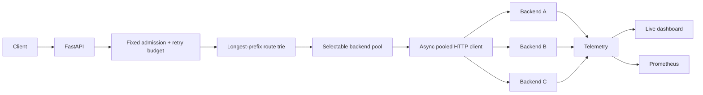

# Pulse — Layer 7 Load Balancer

A recruiter-friendly systems engineering lab, refactored around FastAPI, asynchronous HTTP forwarding and the signal-router dashboard from [codedpool/load-balancer](https://github.com/codedpool/load-balancer) (MIT, see [notice](LICENSES/codedpool-MIT.txt)). The original Node architecture is the basis for the Python port; not every upstream feature is ported. The full upstream text source is preserved in [reference/codedpool](reference/codedpool), pinned to commit 5da9ed5caa02b9e4adc0aef5fc0cbff4acac9362; four binary screenshots are omitted. The previous aiohttp implementation remains available for historical tests and comparisons.

## Quick start

```bash
python -m pip install -r requirements.txt
python -m app.main
```

Open http://127.0.0.1:8080/pulse/. Four actual loopback HTTP backends start automatically. No admin token or external services are needed. Start a bounded traffic test, change algorithms while it runs, take backends offline, add up to two new servers, or compare algorithms in the Battle Arena.

Docker: `docker compose up --build -d load-balancer`. Optional Prometheus and Grafana are available via the existing Compose services. The management interface is a local demo, not authenticated; never publish it to the internet.

## Architecture



| Algorithm | Selection |
| --- | --- |
| Round robin | Rotate through eligible nodes |
| Weighted round robin | Smooth weighted rotation |
| Least connections | Fewest in-flight requests |
| Least latency | Minimum measured EWMA |
| Least loaded | Active requests plus latency score |
| Power of two | Choose the better of two random eligible nodes |
| IP hash | Stable hash of client IP against current eligible list |
| Latency aware | EWMA × (1 + active requests), with cold-start and periodic exploration |

The dashboard displays request throughput, p50/p95/p99, recent error rate, backend share, health, circuit state and activity using bounded samples. Animated dots represent measured aggregate traffic share, not an individual request trace. The arena sends 240 real HTTP requests per algorithm with the same worker count and reports measured throughput, p95 and success. It is a local demonstration, not a controlled production benchmark; results depend on scheduling, connection reuse and current health.

## Structured code

- `app/fastapi_lb/server.py`: FastAPI lifespan, SSE, health probes, control endpoints.
- `app/fastapi_lb/routing.py`: segment trie, backend state, circuit and strategy selection.
- `app/fastapi_lb/proxy.py`: HTTPX forwarding, bounded request bodies, fixed concurrency shedding and GET/HEAD retries.
- `app/fastapi_lb/lab.py`: real local demo backends, load and arena.
- `app/fastapi_lb/telemetry.py`: bounded measurements.
- `app/fastapi_lb/dashboard.html`: adapted upstream UI, with theme, metrics and arena.

To proxy your own locally configured HTTP services, run `python -m app.main --config config/routes.example.json`. Define route prefixes and trusted origins in a JSON/YAML file. The console reports all pools; the strategy selector changes the first configured pool. Demo traffic, server creation and toggles are disabled in configured mode. The route paths are forwarded unchanged. Use `--legacy` to run the previous aiohttp CLI.

## Verification

```bash
python -m pytest tests/unit/test_fastapi_routing.py tests/integration/test_fastapi_lab.py -q
python -m pytest -ra
```

No new performance numbers are claimed. Fixed concurrency shedding replaces the upstream adaptive limiter. Redis rate limiting, multiprocess cluster coordination, hedged requests and automatic infrastructure autoscaling are not ported; server creation is manual and local. HTTPS upstreams use normal certificate validation. WebSocket upgrades are not supported. Historical benchmark files relate to the legacy implementation, not the FastAPI port.


## Distributed systems laboratory

Use the four console sections to run eight hands-on features. Chaos Lab can inject application-level latency, intermittent 500s, 503s, timeouts and outages on loopback backends. Breaking Point offers 50–800 requests/sec in bounded open-loop stages; generator drops are reported separately from proxy rejections. Arena runs all eight strategies under a selected scenario (normal, slow, outage, overload) using 240 requests per algorithm; winner prioritizes success rate, then p95, then throughput. Resilience compares all-enabled with each individual mechanism off; disabling admission retains a 160-request hard cap and disabling pooling requests connection closure. Autoscaling launches and drains real in-process local HTTP listeners (2–6 total, cooldown, no cloud infrastructure). Canary adds a separate v2 backend, adjustable allocation, optional staged auto-promotion, and rollback on an open circuit or measured error/latency breach (20 observations for the statistical check). Request Inspector retains 200 recent demo decisions without URLs, bodies or credentials. Incident replay stores at most 240 half-second snapshots in memory; download the JSON for retention. No packet-level network emulation or production deployment is implied. All experiment controls are local demo only; tests use bounded workloads and no external traffic.
